# 🌊 RobotX 2024: Mechanical Design for an Autonomous Catamaran

My mechanical work as part of **Team Caleuche UC** (Pontificia Universidad Católica de Chile) for the **2024 Maritime RobotX Challenge** in Sarasota, Florida. The team designed, built and operated an autonomous surface vessel (a WAM-V catamaran) that navigates, perceives its surroundings and completes tasks without a human pilot.

  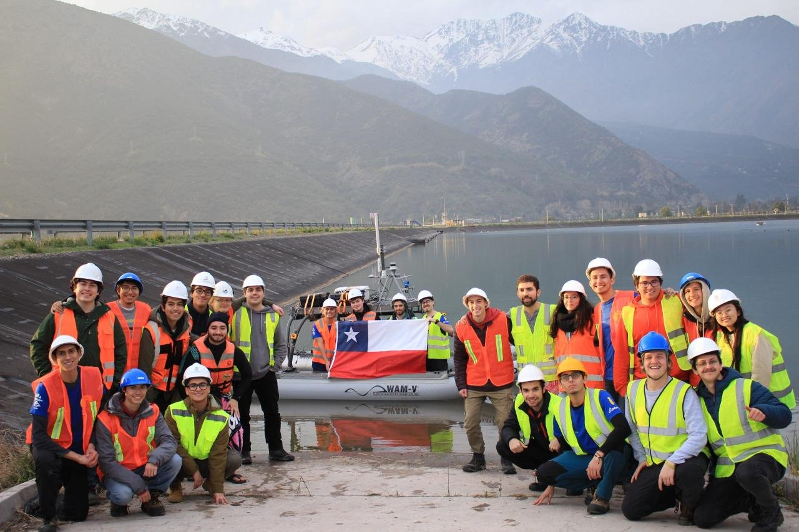

## 🏆 Results

- **5th of 15 international teams** in Design Documentation
- **Gusto & Search Pattern Demonstration Award**

## 👤 My Role

Mechanical team member (Jul 2023 to Dec 2024). I worked on the parts of the vessel where mechanics, electronics and software meet:

| Area | What I did | Outcome |
|---|---|---|
| Navigation sensor structure | Designed and built a modular aluminum-extrusion mast for antennas, cameras, GPS and IMU | Every component position-adjustable by design |
| Systems integration | Worked with the electronics and software teams to define minimum separations between components | No signal interference, correct IMU placement |
| Propeller guard | Optimized the guard geometry with CFD (OpenFOAM) | **+103% downstream wake velocity**, less flow blockage and vibration |
| Sensor thermal management | Diagnosed overheating of the LiDAR and OAK-D PoE camera housings with a thermal camera, then redesigned them with cutouts and heat fins | **Peak temperature 120 °C → 85 °C** |

---

## 🗼 Modular Navigation Mast

The navigation sensors need to sit high, away from each other and from the hull, so I built the mast from **aluminum extrusion**, with mounts that can slide and be re-positioned.

  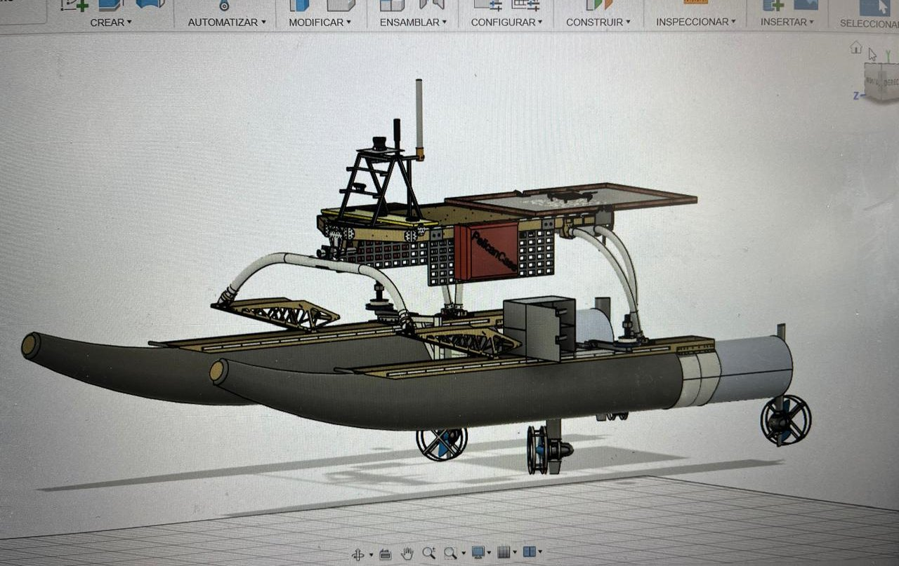
  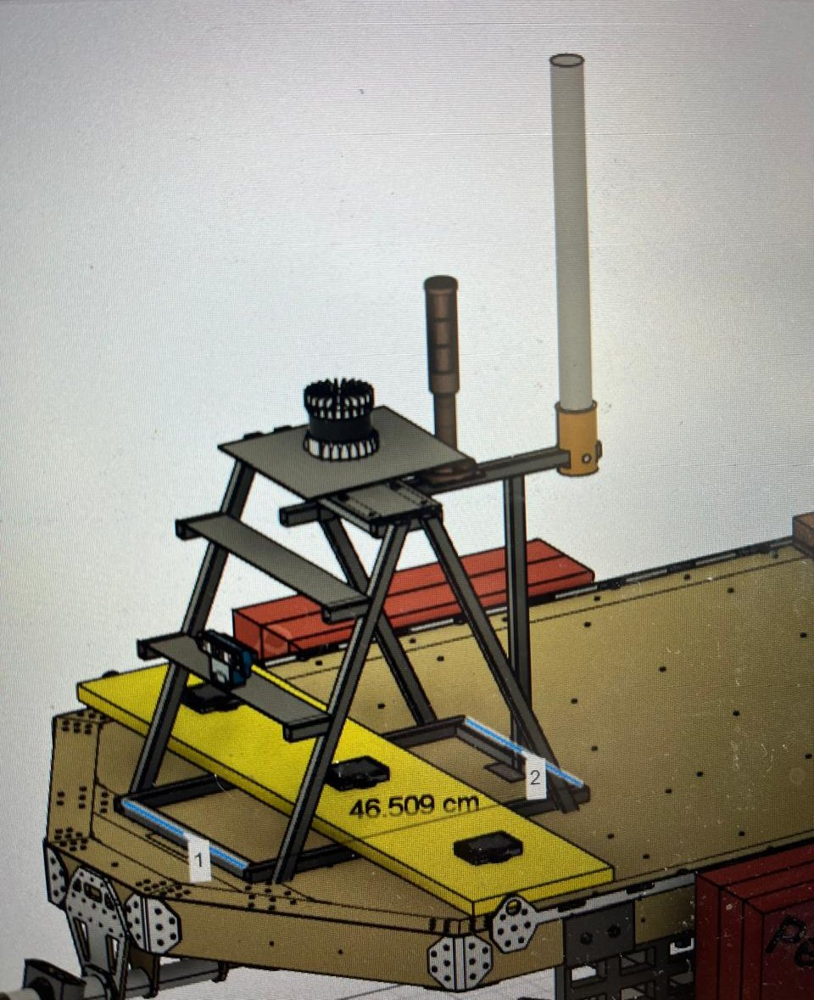

  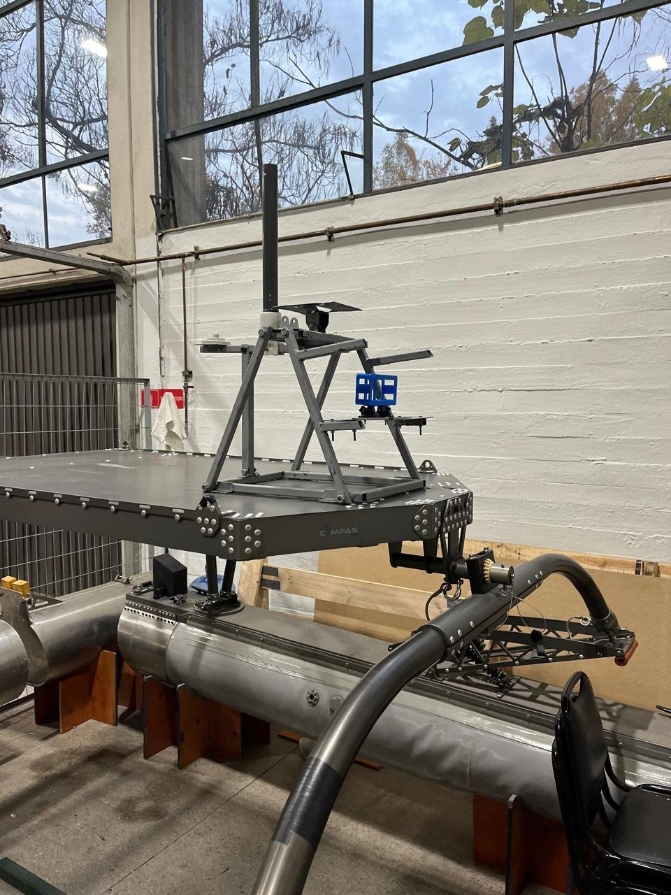
  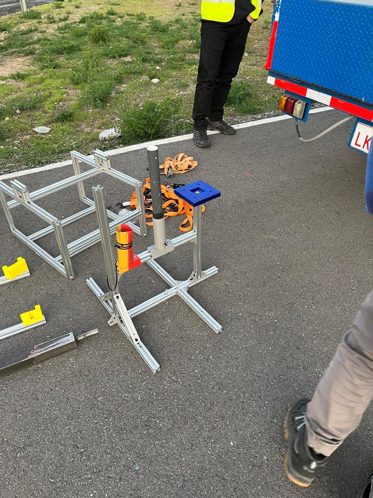
  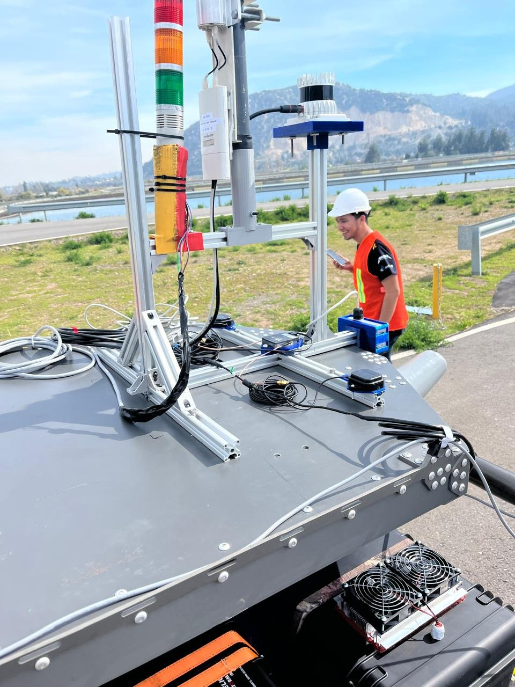

**Integration work with the electronics and software teams:** we verified the minimum viable separations between components so antennas and sensors would not interfere with each other, and placed the IMU correctly. Because every element can be re-positioned, the layout could be adjusted after testing without rebuilding the structure.

---

## 🌡️ Sensor Housing Thermal Redesign

During testing, the LiDAR and the OAK-D PoE camera were overheating inside their housings, reaching **120 °C**. I measured the housings with a **FLIR ONE thermal camera** to find where the heat was building up, and then redesigned them.

  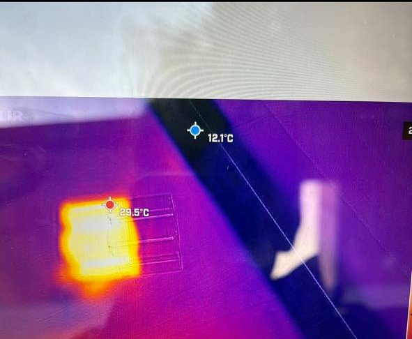
  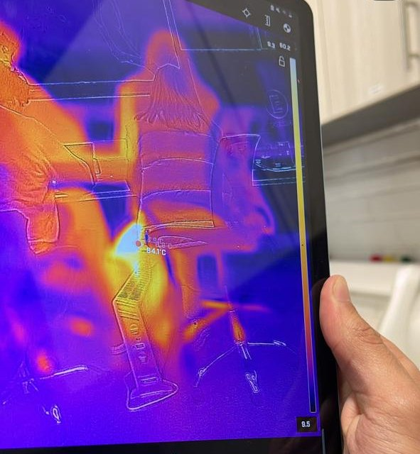

**Changes:** structural cutouts for airflow and heat-dissipation fins on the housings, iterated in CAD and 3D-printed.

  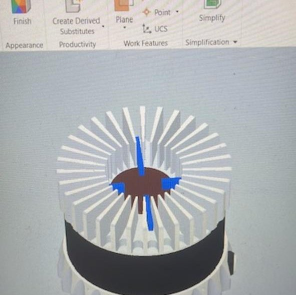
  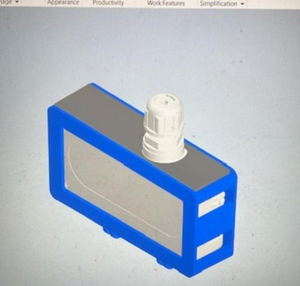
  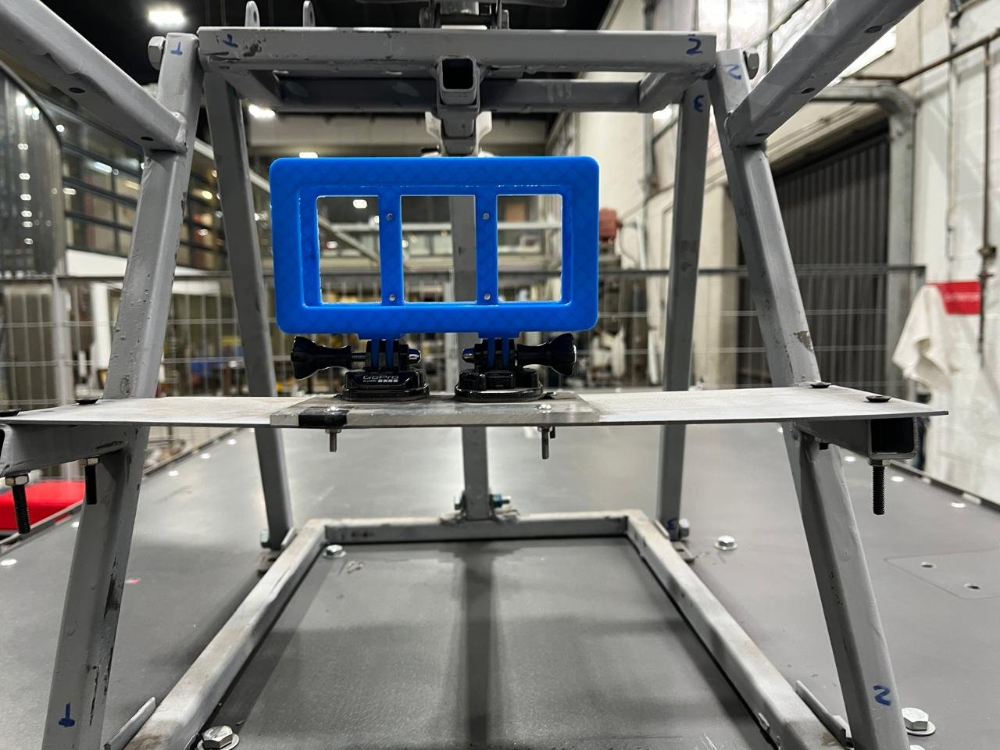

  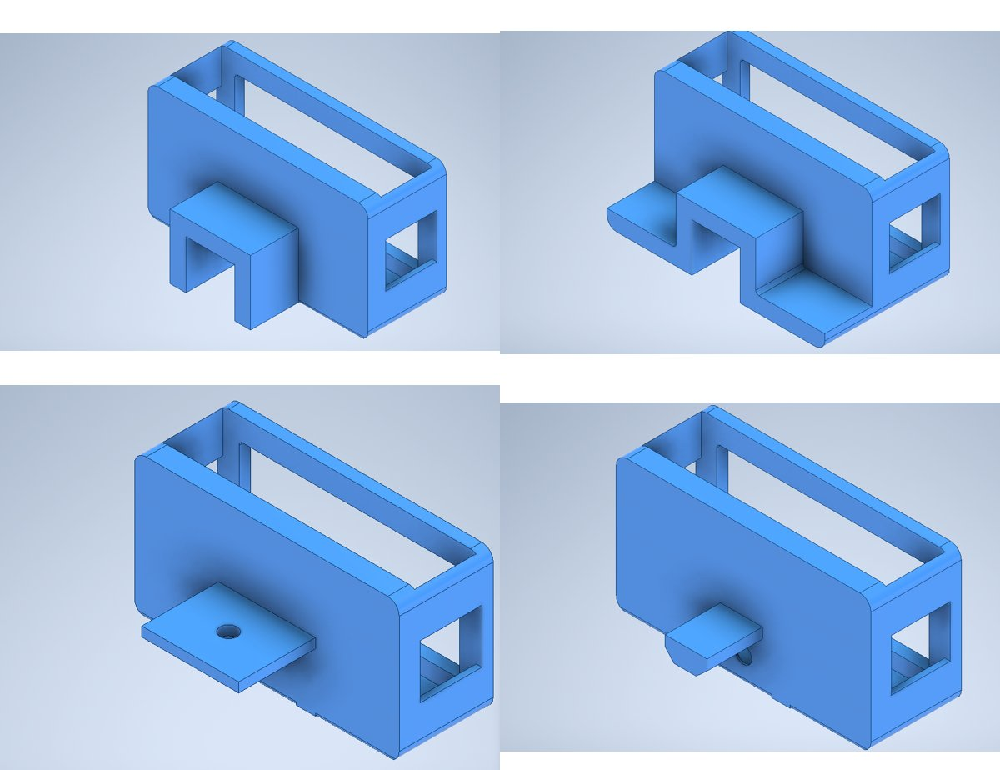
   <em>Design iterations of the camera housing mount (Autodesk Inventor)</em>

I also simulated the heat transfer inside the housing in OpenFOAM to understand the internal air circulation:

  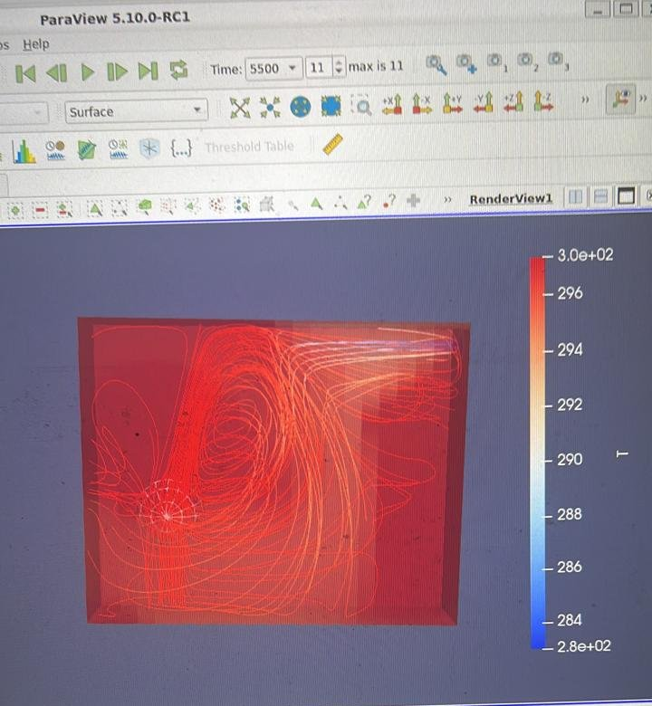

**Result:** peak temperatures dropped from **120 °C to 85 °C**.

---

## 💨 Propeller Guard CFD Optimization

The original propeller guard blocked part of the flow leaving the propellers, which hurt hydrodynamic performance and caused structural vibrations. I modeled the guard in **OpenFOAM** and changed its geometry to open up the flow path.

**Result:** **+103% downstream wake velocity** compared with the original design, with less flow blockage and fewer structural vibrations.

> 📷 Simulation images of the optimized guard will be added here.

---

## 🧰 Tools

## 🔗 Links

- Related CFD work: [openfoam-cfd-simulations](https://github.com/fdosaavedra/openfoam-cfd-simulations)
- Team Caleuche UC: [caleuche.ing.uc.cl](https://caleuche.ing.uc.cl)

---

*Team project. This repository documents my individual contributions to Team Caleuche UC.*
